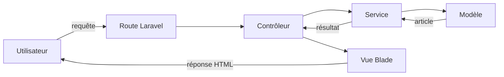
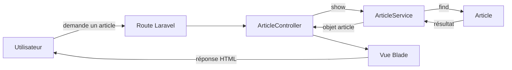

# Architecture du système

## Architecture MVC

Le modèle MVC répartit l'application en trois rôles :

- **Modèle** : représente les données et les règles métier.
- **Vue** : présente les informations avec les gabarits Blade.
- **Contrôleur** : reçoit une requête, appelle les services ou modèles nécessaires et sélectionne la vue.

_Figure : Organisation MVC de la consultation d'un article._

## Architecture du Sprint 1

Pour la première fonctionnalité, le contrôleur reste mince : il récupère les paramètres de la requête et délègue la recherche de l'article à une classe Service.

_Figure : Architecture de la consultation détaillée d'un article._

Le parcours d'une requête est le suivant :

1. L'utilisateur demande la page d'un article à une route Laravel.
2. Le contrôleur appelle le service dédié.
3. Le service utilise le modèle pour récupérer l'article.
4. Le contrôleur transmet les données à une vue Blade.
5. Si l'article n'existe pas, l'application retourne une erreur 404 adaptée.
