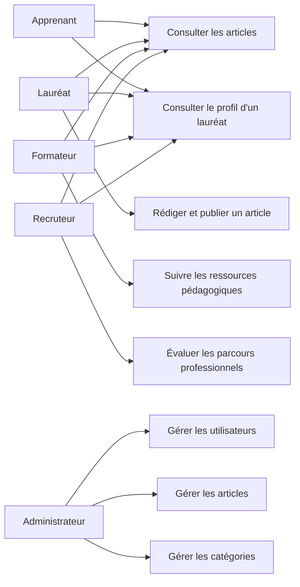
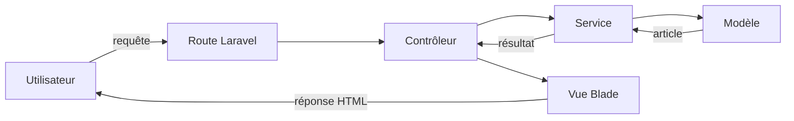
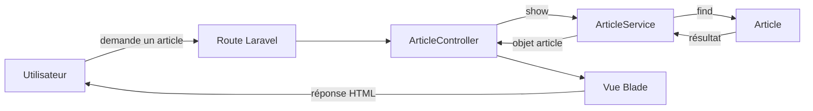
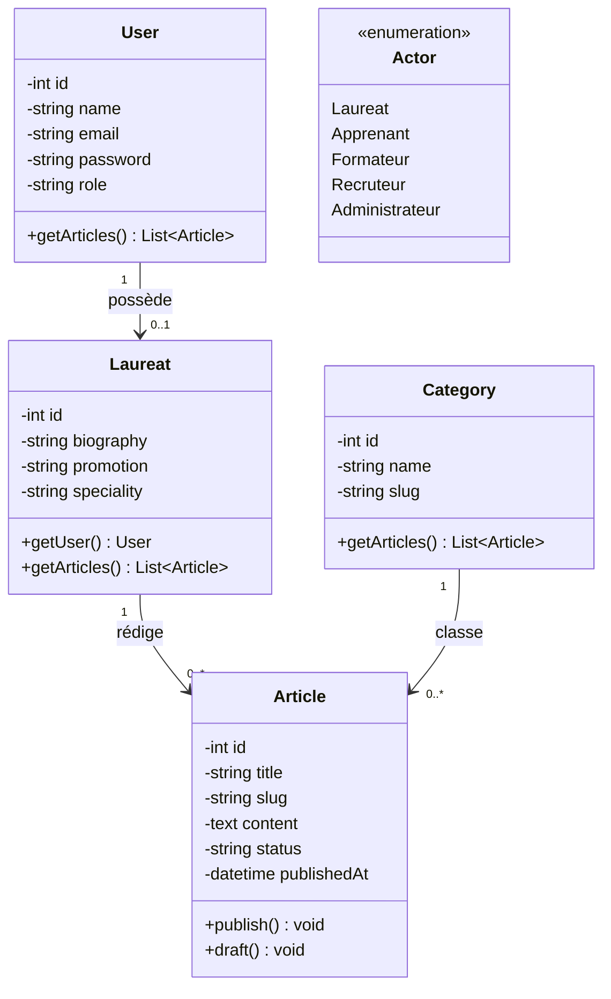

# Rapport de Projet : Blog des Lauréats

> Document consolidé généré automatiquement.

> Date de génération : 2026-11-19

### Remerciements

Je tiens à exprimer ma profonde et sincère gratitude envers toutes les personnes qui ont contribué, de près ou de loin, à l'aboutissement de ce projet de fin d'études. Ce travail n'aurait pu voir le jour sans leur précieux concours, leur engagement et leur bienveillance.

En premier lieu, j'adresse mes remerciements les plus chaleureux à M. ES-SARRAJ Fouad., mon encadrante pédagogique, dont les conseils avisés, la rigueur scientifique et la disponibilité permanente ont été des guides indispensables tout au long de la conduite de ce projet. Ses orientations méthodologiques et ses retours critiques ont considérablement enrichi la qualité de ce travail.

Je remercie également l'ensemble du corps professoral et administratif de Solicode pour la qualité de la formation dispensée, qui m'a fourni les outils conceptuels et techniques nécessaires à la réalisation de ce projet. Chaque cours, chaque atelier pratique et chaque projet académique ont contribué à forger les compétences mobilisées dans ce mémoire.

Ma reconnaissance va également à mes camarades de promotion pour les échanges intellectuels fructueux, l'entraide permanente et le partage de connaissances qui ont caractérisé notre cohabitation académique. Ces interactions ont nourri ma réflexion et stimulé ma créativité tout au long du processus de développement.

Enfin, je ne saurais clore ces remerciements sans exprimer ma profonde gratitude envers ma famille, dont le soutien moral et matériel m'a permis de mener mes études dans les meilleures conditions possibles. Leur foi en mes capacités a été le moteur de ma persévérance.

Merci à tous.

# Introduction

Le **Blog des Lauréats** est un projet pédagogique réalisé dans le cadre de la formation développeur web à Solicode Tanger. Il vise à mettre en valeur les parcours professionnels des lauréats et à partager leurs expériences avec les apprenants actuels.

L'application permettra principalement de consulter les articles publiés, d'afficher le profil des auteurs et d'administrer les contenus selon les rôles attribués.

Les principaux acteurs sont le lauréat, qui partage son expérience, l'apprenant, qui découvre les parcours professionnels, le formateur, qui accompagne et encadre les apprenants, le recruteur, qui consulte les profils pour évaluer les compétences, et l'administrateur, qui gère la plateforme.

Le projet est conduit progressivement avec les méthodes Scrum et 2TUP : l'analyse fonctionnelle décrit les besoins des utilisateurs, tandis que l'analyse technique définit les choix d'architecture et les technologies.

# Chapitre 2 : Conclusion

# Contexte du projet

Solicode Tanger forme des apprenants aux métiers du développement numérique. À la fin de leur parcours, les lauréats possèdent des retours d'expérience utiles pour les promotions suivantes. Le Blog des Lauréats répond au besoin de rendre ces témoignages accessibles, structurés et durables.

Les utilisateurs concernés sont les lauréats, les apprenants, les formateurs, les recruteurs et les administrateurs du blog. Le projet doit faciliter la consultation des articles, la publication de contenus professionnels, l'accompagnement pédagogique et la gestion administrative de la plateforme.

# Cahier des charges

## Objectifs fonctionnels

- Permettre à chaque acteur d'accéder aux fonctionnalités correspondant à son rôle.
- Consulter la liste des articles publiés.
- Consulter le détail d'un article.
- Présenter les lauréats auteurs, leurs parcours et leurs expériences professionnelles.
- Permettre aux lauréats autorisés de rédiger et publier des articles.
- Permettre aux apprenants de consulter les articles et les profils des lauréats.
- Permettre aux formateurs de suivre les contenus destinés aux apprenants.
- Permettre aux recruteurs de consulter les profils pour évaluer les parcours professionnels.
- Permettre aux administrateurs de gérer les utilisateurs, les articles et les catégories.
- Afficher une page d'erreur adaptée lorsqu'un article n'existe pas.

## Contraintes techniques

- Utiliser PHP, Laravel et une architecture MVC.
- Utiliser Blade pour les vues.
- Utiliser MySQL pour la persistance des données dans la version complète.
- Produire une interface responsive.
- Respecter les règles d'authentification et d'autorisation définies pour les rôles.
- Documenter les travaux avec Markdown, Mermaid et les outils de présentation du dépôt.

# Méthodologie de travail

# Méthode de travail

## La méthode SCRUM

La méthodologie Scrum permet de gérer le développement du Blog des Lauréats de manière flexible et progressive. Le projet est découpé en sprints, puis les fonctionnalités sont priorisées, réalisées, vérifiées et intégrées selon les résultats obtenus.

_Figure 3 : La méthode SCRUM_

**Principe Scrum :**

- **Transparence** : visibilité complète sur les tâches, les objectifs et l'avancement du projet pour toute l'équipe.
- **Inspection** : évaluation régulière à la fin de chaque sprint afin d'identifier les erreurs, les blocages et les axes d'amélioration.
- **Adaptation** : ajustement du plan de travail en fonction des retours et des résultats obtenus lors des sprints.

**Organisation du projet en sprints :**

### Sprint 1 : initialisation et première fonctionnalité

Le Sprint 1 comprend l'initialisation du dépôt, la configuration de l'environnement, le cadrage du projet, la modélisation fonctionnelle, la gestion du backlog et l'implémentation de la consultation détaillée d'un article.

L'architecture retenue pour cette première fonctionnalité sépare un contrôleur Laravel mince d'une classe Service contenant la logique de récupération de l'article. Une vue Blade présente les informations et une réponse HTTP adaptée est affichée lorsque l'article n'existe pas.

# Design thinking

Ainsi, l'adoption de Scrum permet d'assurer une organisation progressive du travail autour du Blog des Lauréats. La collaboration, les revues de sprint et les ajustements réguliers servent à maintenir l'application alignée avec les besoins de ses utilisateurs.

## Design thinking

Le Design Thinking est une approche de résolution de problèmes centrée sur l’humain. Elle vise à comprendre en profondeur les besoins réels des utilisateurs afin de concevoir des solutions innovantes, utiles et adaptées. Cette méthode est largement utilisée dans les domaines du design, de la technologie, de l’éducation et de l’innovation pour répondre à des problématiques complexes.

_Figure : Méthodologie Design Thinking_

Le Design Thinking est particulièrement utilisé pour :

- Encourager la créativité et l’innovation dans la conception de solutions ;
- Proposer des réponses réellement adaptées aux besoins des utilisateurs ;
- Favoriser la collaboration entre différentes équipes de travail ;
- Résoudre des problèmes complexes ou mal définis de manière structurée.

## Les étapes du Design Thinking

Le processus du Design Thinking se compose de plusieurs étapes essentielles :

- **Empathie (Empathize)** : cette étape consiste à comprendre l’utilisateur en l’observant, en l’interrogeant et en analysant son comportement. L’objectif est d’identifier ses besoins, ses attentes et ses difficultés réelles.
- **Définition du problème (Define)** : elle permet de regrouper les informations collectées afin de formuler un problème clair et centré sur l’utilisateur, souvent exprimé sous forme de question comme : « Comment pourrions-nous améliorer… ? »
- **Idéation (Ideate)** : cette phase consiste à générer un maximum d’idées possibles sans jugement, en utilisant des techniques comme le brainstorming ou le mind mapping afin de stimuler la créativité.
- **Prototype** : elle consiste à créer une version simplifiée de la solution proposée (maquette, interface ou modèle) afin de tester rapidement les idées.
- **Test** : cette dernière étape permet de tester le prototype auprès des utilisateurs, de recueillir leurs retours et d’améliorer la solution en fonction des résultats obtenus.

Le Design Thinking est donc une méthode structurée et flexible qui permet de transformer une idée en solution concrète en mettant toujours l’utilisateur au centre du processus.

# Planification

# Branche fonctionnelle

La branche fonctionnelle analyse les besoins des acteurs du Blog des Lauréats :

- le **lauréat** rédige des articles et présente son parcours ;
- l'**apprenant** consulte les retours d'expérience et découvre les compétences professionnelles ;
- le **formateur** accompagne les apprenants et peut superviser les ressources pédagogiques ;
- le **recruteur** consulte les profils et les articles afin d'évaluer les candidats ;
- l'**administrateur** gère les utilisateurs, les articles et les catégories.

Les fonctionnalités sont définies en fonction de ces rôles afin d'assurer une navigation adaptée et des autorisations cohérentes.

# Carte d'empathie

## Apprenant

- **Voit** : des articles techniques, des témoignages et les parcours des lauréats.
- **Entend** : les conseils des formateurs et les expériences de professionnels ayant terminé la formation.
- **Pense** : aux compétences nécessaires pour réussir sa formation et son insertion professionnelle.
- **Ressent** : le besoin d'exemples concrets, clairs et inspirants.

## Lauréat

- **Voit** : une plateforme permettant de présenter ses réalisations.
- **Entend** : l'intérêt des apprenants et des recruteurs pour son parcours.
- **Pense** : à transmettre une expérience professionnelle utile.
- **Ressent** : le besoin d'une interface simple pour publier ses articles.

## Formateur

- **Voit** : les ressources utilisées pour accompagner les apprenants.
- **Pense** : à la qualité pédagogique et à la pertinence des contenus.
- **Ressent** : le besoin de pouvoir orienter les apprenants vers des témoignages adaptés.

## Recruteur

- **Voit** : les parcours, compétences et expériences des lauréats.
- **Pense** : à l'adéquation du profil avec ses besoins professionnels.
- **Ressent** : le besoin d'informations fiables et faciles à consulter.

# Définition du problème

Les expériences des lauréats ne sont pas suffisamment centralisées et faciles à consulter. Les apprenants doivent pouvoir s'inspirer de parcours réels, les formateurs doivent disposer de références professionnelles pertinentes, et les recruteurs doivent pouvoir évaluer rapidement les profils publiés.

Le Blog des Lauréats vise à résoudre ce problème en proposant une plateforme de publication et de consultation structurée autour de cinq acteurs : le lauréat, l'apprenant, le formateur, le recruteur et l'administrateur.

# Idéation

# Diagramme de cas d'utilisation

# Branche technique

Dans cette section, nous présentons la branche technique de notre projet, qui consiste à décrire les choix technologiques, les outils et les architectures adoptés pour assurer le bon fonctionnement de l'application, tout en garantissant une solution performante, sécurisée et adaptée aux besoins identifiés.

---

## Choix technologiques

Dans le cadre du Blog des Lauréats, plusieurs technologies modernes ont été sélectionnées pour garantir la maintenabilité, la sécurité et la rapidité de la plateforme.

### Technologies Backend

- **PHP 8.2+ et Laravel** : Ce duo technologique est utilisé pour développer le backend en architecture MVC, garantissant une base sécurisée, des performances accrues et un code structuré.

### Technologies Frontend

- **Blade Templates** : Moteur de rendu HTML, natif de Laravel, utilisé pour structurer l'interface utilisateur en composants réutilisables.
- **Tailwind CSS** : Framework CSS utilitaire ultra-rapide, permettant de concevoir une interface sur mesure, moderne, responsive et compatible mode sombre.
- **Alpine** : Framework JavaScript léger et réactif, utilisé pour les animations du frontend (barres de recherche, modales, menus déroulants).
- **Preline** : Bibliothèque de composants UI basés sur Tailwind CSS, accélérant le développement avec des modèles prêts à l'emploi.
- **Vite** : Outil de build moderne, optimisant la compilation des ressources CSS/JS pour un chargement de page ultra-rapide en production.

### Base de données

- **MySQL** : Système de gestion de base de données relationnelle (SGBDR) fiable, utilisé pour stocker l'intégralité des données de l'application.

### Outils et utilitaires externes

- **Mermaid** : Outil permettant de générer des schémas et diagrammes à partir d'une syntaxe textuelle simple.
- **PlantUML** : Solution utilisée pour concevoir les différents diagrammes UML nécessaires à l'analyse et à la documentation du système.

# Stack technologique

# Architecture du système

## Architecture MVC

Le modèle MVC répartit l'application en trois rôles :

- **Modèle** : représente les données et les règles métier.
- **Vue** : présente les informations avec les gabarits Blade.
- **Contrôleur** : reçoit une requête, appelle les services ou modèles nécessaires et sélectionne la vue.

_Figure : Organisation MVC de la consultation d'un article._

## Architecture du Sprint 1

Pour la première fonctionnalité, le contrôleur reste mince : il récupère les paramètres de la requête et délègue la recherche de l'article à une classe Service.

_Figure : Architecture de la consultation détaillée d'un article._

Le parcours d'une requête est le suivant :

1. L'utilisateur demande la page d'un article à une route Laravel.
2. Le contrôleur appelle le service dédié.
3. Le service utilise le modèle pour récupérer l'article.
4. Le contrôleur transmet les données à une vue Blade.
5. Si l'article n'existe pas, l'application retourne une erreur 404 adaptée.

# Prototype (fonctionnalités, classes)

# Conception

# Diagramme de classes

# Maquettes

# Réalisation

# Interfaces

## 2.3 2TUP

### Définition

La méthode **2TUP** (_Two Tracks Unified Process_) est une méthode de
développement logiciel agile et itérative. Elle peut être adaptée au contexte
du **Blog des Lauréats**, à ses objectifs et aux besoins des lauréats,
des apprenants, des formateurs, des recruteurs et des administrateurs.

Sa particularité repose sur une architecture en « Y » qui sépare
distinctement deux axes de réflexion :

- **la branche fonctionnelle**, consacrée à la compréhension des utilisateurs,
  des processus et des besoins métier ;
- **la branche technique**, consacrée à l'étude des contraintes techniques,
  à la conception de l'architecture et au choix des technologies.

La branche fonctionnelle permet de définir la consultation des articles,
la gestion des auteurs et l'administration des contenus, tandis que la branche
technique permet de déterminer l'architecture, les technologies Laravel et
MySQL ainsi que les outils de présentation.

Ces deux branches progressent en parallèle, puis se rejoignent dans une phase
de réalisation. Cette organisation permet de limiter les risques, de vérifier
la cohérence entre les besoins métier et la solution technique, et de faire
évoluer progressivement le produit.

### Schéma

Le schéma suivant présente le fonctionnement général de la méthode 2TUP
appliqué au Blog des Lauréats.

**Figure : Processus 2TUP appliqué au Blog des Lauréats**

La branche fonctionnelle part de la capture des besoins et aboutit à
l'analyse fonctionnelle. En parallèle, la branche technique part des besoins
techniques et aboutit à la définition de l'architecture et des technologies.
La convergence des deux branches déclenche la phase de réalisation, qui
comprend la conception, le codage, les tests, la recette et le déploiement.

### Conclusion

La méthode 2TUP fournit un cadre de travail structuré et adaptable pour la
réalisation du **Blog des Lauréats**. La séparation entre les branches
fonctionnelle et technique facilite la compréhension des besoins et permet de
prendre les décisions techniques au moment approprié.

En réunissant ces deux branches dans une phase de réalisation progressive,
la méthode favorise la maîtrise des risques, l'amélioration continue et
l'alignement du produit final sur les besoins des lauréats, des apprenants,
des formateurs, des recruteurs et des administrateurs. Elle constitue ainsi une approche pertinente pour
les projets dont les exigences fonctionnelles et les contraintes techniques
doivent être analysées conjointement.

# Conclusion

